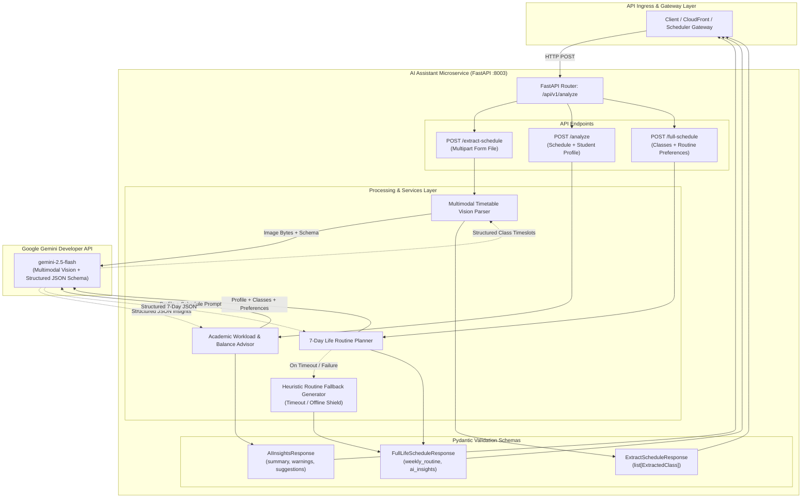

# AI Assistant Microservice (`ai-assistant-api`)

An intelligent advisory and multimodal scheduling microservice powered by **FastAPI** and the **Google Gemini SDK** (`gemini-2.5-flash`). It provides automated timetable extraction from screenshots, academic workload analysis, and comprehensive 7-day life routine synthesis.

---

## Architecture



---

## Features

- **Timetable Image Extraction (`POST /api/v1/analyze/extract-schedule`)**:
  - Uses Gemini Multimodal Vision to inspect uploaded timetable screenshots (PNG, JPG, WEBP).
  - Automatically identifies days, course IDs, titles, start/end times, and room locations.
- **Academic Schedule Analysis (`POST /api/v1/analyze`)**:
  - Evaluates enrolled courses, credit balance, and study difficulty.
  - Generates executive summaries, risk warnings, and actionable recommendations.
- **7-Day Life Routine Synthesis (`POST /api/v1/analyze/full-schedule`)**:
  - Synthesizes an end-to-end 7-day routine that integrates fixed academic classes with personal life preferences:
    - Commute transit buffers before and after campus classes.
    - Wake-up and bedtime schedules.
    - Daily study sessions based on target study hours.
    - Gym and workout sessions aligned with morning/afternoon/evening preferences.
    - Meal and personal relaxation blocks.
  - Built-in graceful heuristic fallback generator if the external AI service is unreachable or exceeds timeouts.

---

## API Endpoints

| Method | Endpoint | Description |
| :--- | :--- | :--- |
| `POST` | `/api/v1/analyze` | Generates AI insights for a proposed course schedule. |
| `POST` | `/api/v1/analyze/extract-schedule` | Extracts class schedules from timetable images (`multipart/form-data`). |
| `POST` | `/api/v1/analyze/full-schedule` | Builds a complete 7-day daily and weekly life schedule. |
| `GET` | `/health` | Health check probe for Kubernetes readiness and liveness. |

---

## Configuration & Environment Variables

Configure via `.env` file or Kubernetes secrets:

| Variable | Default | Description |
| :--- | :--- | :--- |
| `GEMINI_API_KEY` | *(required)* | Google Gemini API Key. |
| `GEMINI_MODEL` | `gemini-2.5-flash` | Gemini model name. |
| `PORT` | `8003` | Port for the HTTP server. |
| `HOST` | `0.0.0.0` | Host bind address. |

---

## Local Development

### Prerequisites
- Python 3.12+
- Valid Google Gemini API Key

### Setup & Run
```bash
# Create virtual environment
python -m venv venv
source venv/bin/activate  # On Windows: .\venv\Scripts\activate

# Install dependencies
pip install -r requirements.txt

# Run the server with hot reload
uvicorn src.main:app --host 0.0.0.0 --port 8003 --reload
```

### Running Tests
```bash
pytest tests/ -v
```

---

## Containerization & Deployment

```bash
# Build Docker image
docker build -t ghcr.io/prospjx/ai-assistant-api:latest .

# Deploy via Helm (GitOps)
helm upgrade --install ai-assistant-api ../gitops/charts/ai-assistant-api
```
